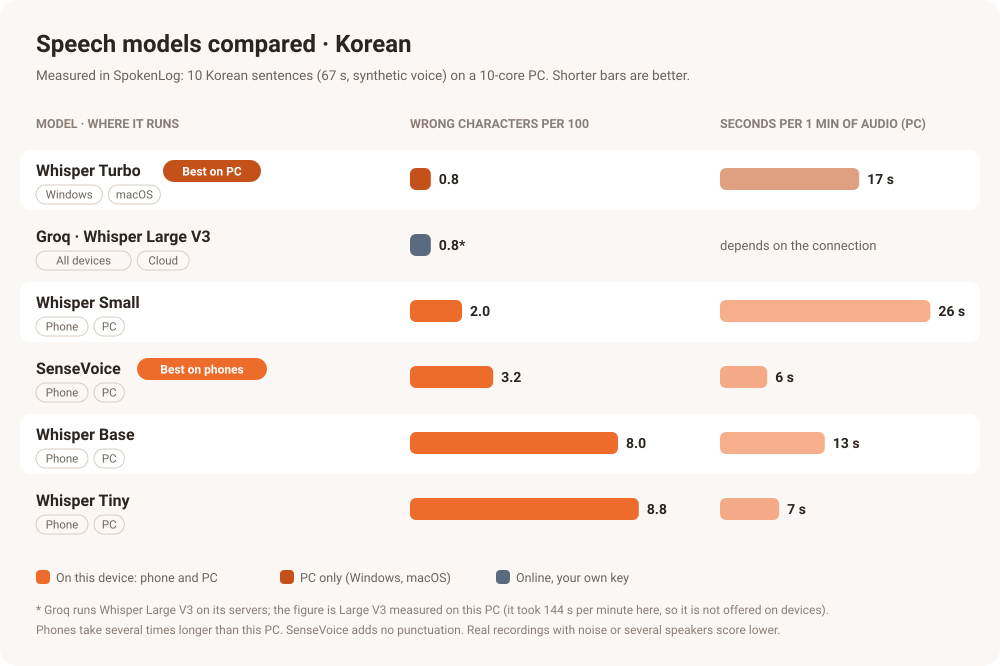

# SpokenLog

Record audio or import a file, transcribe it locally or with your own cloud credentials, then edit and export the transcript.

https://github.com/user-attachments/assets/cf12c70e-a913-4209-887f-9ed36139ffa6

## Download

Download the [latest release](https://github.com/Blue-B/SpokenLog/releases/latest) for your platform. Back up important recordings before updating.

| Platform | Download | Note |
| --- | --- | --- |
| Android 7.0+ | [APK](https://github.com/Blue-B/SpokenLog/releases/latest/download/SpokenLog-Android.apk) | Development-signed |
| Windows x64 | [Setup.exe (recommended)](https://github.com/Blue-B/SpokenLog/releases/latest/download/SpokenLog-Windows-x64-Setup.exe) / [ZIP (no install)](https://github.com/Blue-B/SpokenLog/releases/latest/download/SpokenLog-Windows-x64.zip) | Unsigned |
| macOS 12+ | [ZIP (0.1.3)](https://github.com/Blue-B/SpokenLog/releases/download/v0.1.3/SpokenLog-macOS.zip) | Not notarized; 0.2.x build pending |
| iOS / iPadOS 15+ | [Unsigned IPA (0.1.3)](https://github.com/Blue-B/SpokenLog/releases/download/v0.1.3/SpokenLog-iOS-unsigned.ipa) | Re-signing required; not tap-to-install; 0.2.x build pending |

These are direct-download builds, not App Store or Google Play releases. Follow the [installation guide](docs/installation.md) for your platform.

[Checksums](https://github.com/Blue-B/SpokenLog/releases/latest/download/SHA256SUMS.txt) | [Release notes, known issues and verification scope](https://github.com/Blue-B/SpokenLog/releases/latest)

## Features

- Recording library with search, collections, favorites and timestamped playback.
- Local SenseVoice or Whisper (Tiny, Base, Small, and Turbo on PCs); cloud transcription with your own Groq or Cloudflare credentials.
- Transcript editing, local speaker labels, and TXT, SRT, VTT or JSON export.
- Imports M4A, MP3, FLAC, OGG, MP4 and other audio or video files, converting them to WAV for local transcription. On Android the picker opens in the Samsung Voice Recorder folder; on iPhone, share a recording from Voice Memos to SpokenLog.
- Read-only AI connection (MCP) on Windows and macOS: let Claude Code, Codex, pi, Claude or ChatGPT search your transcripts.

Local transcription keeps audio on your device. Cloud transcription uploads audio to the selected provider. The interface supports English and Korean; spoken-language support depends on the engine.

## Choosing a transcription engine



- **Phones (Android, iPhone):** SenseVoice. It is the fastest and makes few mistakes; it adds no punctuation. Whisper Small is a little more accurate but about four times slower.
- **PCs (Windows, macOS):** Whisper Turbo. It made the fewest mistakes and takes about 17 seconds per minute of audio.
- **Online:** Groq runs Whisper Large V3 with your own free key. The audio is uploaded to Groq.

Choosing an on-device model in **Settings > How to transcribe** downloads it then. The figures come from one synthetic voice reading ten sentences, not a public benchmark; real recordings vary.

## AI connection (MCP)

Turn on **Settings > AI connection (MCP)** in the desktop app, copy the address, and add it to your AI tool:

```sh
claude mcp add -s user --transport http spokenlog <address>   # Claude Code
codex mcp add spokenlog --url <address>                       # Codex
```

The AI can list, search and read transcripts but cannot change anything. Transcripts it reads go to that AI's provider unless you use a local model. Setup for pi, Claude Desktop, and ChatGPT or Claude on the web (via a tunnel) is in the [AI connection guide](docs/mcp.md).

## Documentation

[Features and formats](docs/features.md) | [AI connection (MCP)](docs/mcp.md) | [Build from source](docs/development.md) | [Data management and removal](docs/desktop-removal.md) | [Release history](https://github.com/Blue-B/SpokenLog/releases)

[AGPL-3.0-only](LICENSE) | [Branding policy](TRADEMARKS.md)
